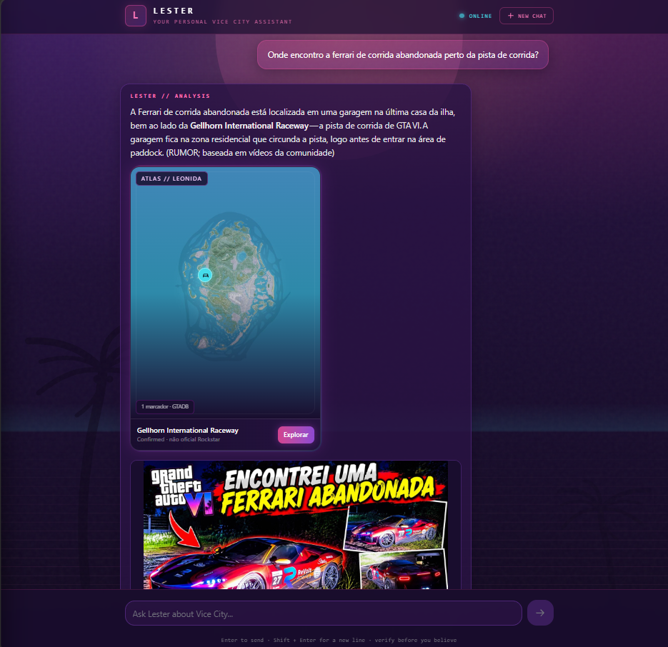

# LESTER — GTA VI AI Research Agent

A chat agent for GTA VI, for those who know the "creepy uncle lester" from GTA V, its basicly a AI served from Groq (LLM) connected to Tavily for web searching cars, money methods, overall improving your GTA VI experience, he shows you locations via interactive game map, images, sources and much more.



## How it works

1. The browser sends the conversation to `POST /api/chat` on the same Worker that serves the app.
2. The Worker validates the request and asks Groq for a JSON decision: a search query, or `null`.
3. If needed, the Worker calls Tavily, feeds the results back to Groq, and returns the answer with numbered citations. No tool-calling schema involved.
4. Groq marks chosen images with `[IMG1]`/`[IMG2]` and places with `[MAP:name]`; the Worker converts those markers into validated images and map markers, and the frontend renders a gallery plus a local map preview. Open the preview for the interactive atlas: zoom, drag, search, category filters, legend, clickable markers with descriptions/confidence/source, and reset. The map image is `public/gta6-map.jpg`, a crop of GTADB's in-game day map (CC BY 4.0, `rolux/gtadb.org`); positions come from GTADB landmark coordinates and approximate areas are labelled as such. It is a community map, not an official Rockstar Games map. If no usable image or known place is found, nothing extra is shown. Conversation history lives only in browser memory until reload.

API keys stay in Worker Secrets (or `.dev.vars` locally). They are never bundled into the React app.

## Project structure

```
.
├── index.html                 Vite entry point
├── package.json               scripts and dependencies
├── tsconfig.json              TypeScript config
├── vite.config.ts             React + Tailwind build, /api proxy for local dev
├── wrangler.jsonc             Worker config, assets, model variable
├── .dev.vars.example          local key template
├── types.ts                   shared message/source types
├── worker/
│   └── index.ts               Worker: static assets, /api/chat, Groq loop, Tavily
├── src/
│   ├── main.tsx               React entry
│   ├── App.tsx                chat state, welcome screen, scroll
│   ├── index.css              Tailwind + terminal theme
│   ├── components/
│   │   ├── Header.tsx
│   │   ├── MessageBubble.tsx
│   │   ├── SourceList.tsx
│   │   ├── Composer.tsx
│   │   └── ThinkingIndicator.tsx
│   └── lib/chat.ts            frontend API client
└── scripts/
    ├── dev.mjs                runs Vite + Wrangler together
    └── selfcheck.mjs          mocked end-to-end Worker check
```

## Deployment guide (from zero)

### 1. Install the software

- **Node.js 24** (20.19+ or 22.12+ also works): <https://nodejs.org/> — install the LTS version.
- **npm** comes with Node.js.
- A free **Cloudflare account**: <https://dash.cloudflare.com/sign-up>.
- Wrangler is installed locally by `npm install`; no global install needed.

Check your versions:

```bash
node --version
npm --version
```

### 2. Get the API keys

**Groq**

1. Sign in at <https://console.groq.com/keys>.
2. Click **Create API Key**, give it a name, copy the key. It starts with `gsk_`.
3. Keep it private; it is shown only once.

**Tavily**

1. Sign up / sign in at <https://app.tavily.com/>.
2. Open the API Keys section of the dashboard and copy your key. It usually starts with `tvly-`.
3. Tavily's free tier has a limited number of monthly search credits — enough for personal use.

### 3. Install dependencies

From the project folder:

```bash
npm install
```

### 4. Configure the keys securely

For the **deployed** Worker, store each key as a Secret (Wrangler prompts you to paste the value):

```bash
npx wrangler secret put GROQ_API_KEY
npx wrangler secret put TAVILY_API_KEY
```

Confirm with:

```bash
npx wrangler secret list
```

You should see both names, never their values. Secrets are encrypted and only available inside the Worker, never in frontend JavaScript.

For **local development**, copy the template and fill in your keys:

```bash
cp .dev.vars.example .dev.vars
```

Edit `.dev.vars`:

```
GROQ_API_KEY=gsk_your_real_key_here
TAVILY_API_KEY=tvly-your_real_key_here
```

`.dev.vars` is gitignored. Never commit it or paste it into frontend code.

### 5. Run locally

```bash
npm run dev
```

This starts both processes:

- Frontend: <http://localhost:5173>
- Worker API: <http://localhost:8787> (Vite proxies `/api` to it)

Open <http://localhost:5173> and ask a question. To stop, press `Ctrl+C`.

If you prefer two terminals:

```bash
npm run dev:api
```

```bash
npm run dev:web
```

### 6. Deploy

First time only, log in to Cloudflare:

```bash
npx wrangler login
```

Then deploy (builds the React app and uploads the Worker + assets):

```bash
npm run deploy
```

Wrangler prints the deployment URL, for example:

```
https://lester.example-subdomain.workers.dev
```

Open that URL in a browser. That is your live site — there is no separate frontend URL.

### 7. Find the URL again later

- Run `npx wrangler deployments list`, or
- Cloudflare dashboard → **Workers & Pages** → `lester` → the deployment URL shown on the overview page.

If `workers.dev` subdomains are disabled on your account, add a route or custom domain in the Worker's **Settings → Triggers** in the dashboard, then use that hostname instead.

### 8. Verify it works

- Ask a general question (e.g. "Who are you?") — no search should happen.
- Ask a factual GTA VI question (e.g. "What vehicles are confirmed for GTA VI?") — a **Sources** section should appear with clickable links.
- Ask about GTA V and confirm Lester says it is a different game.
- View page source / bundled JS in the browser and search for your keys — they must not appear.

Run the mocked Worker check any time (no API keys required):

```bash
npm run check
```

## Configuration you may want to change

- `wrangler.jsonc` → `vars.GROQ_MODEL`: default `openai/gpt-oss-120b`. Change it to another Groq model ID if desired, then run `npm run deploy`. If Groq returns 404, the model ID was retired; list active IDs with:
  ```bash
  curl -s https://api.groq.com/openai/v1/models -H "Authorization: Bearer $GROQ_API_KEY" | grep '"id"'
  ```
- `worker/index.ts` → `MAX_SEARCHES`, `MAX_RESULTS`, `MAX_TURNS`, and timeouts: limits for cost control.
- `worker/index.ts` → `SYSTEM_PROMPT`: personality and accuracy rules.

## Troubleshooting

| Problem | What to do |
| --- | --- |
| `The assistant is not configured yet.` | Secrets are missing. Run both `wrangler secret put` commands, then retry. |
| `The language model is unavailable right now.` (502) | Check the Groq key, quota and chosen model in the Groq dashboard. Check `wrangler tail` for the upstream status. |
| `The search service is unavailable right now.` (502) | Check the Tavily key and remaining credits. |
| `Groq did not respond in time` / `504` | Temporary upstream timeout; retry. |
| Local `/api/chat` fails or returns 404 | Make sure both processes are running (`npm run dev`) and `.dev.vars` exists with valid keys. |
| `npm run build` fails | Use Node 20.19+ / 22.12+ (Node 24 recommended), then `npm install` again. |
| Deploy fails with authentication error | Run `npx wrangler login` or `npx wrangler whoami`. |
| Deployed site shows 404 for assets | Always deploy with `npm run deploy` (it builds first), not bare `wrangler deploy`. |
| Need live logs | Run `npx wrangler tail` in a terminal while using the site. |

## Checks already performed

- `npm run build` — TypeScript and Vite production build pass.
- `npm run check` — mocked Groq tool-call loop, Tavily call, citation filtering, validation, and no-key-leak assertions pass.
- `npx wrangler deploy --dry-run` — Worker bundles cleanly with the asset directory.
- Local `wrangler dev` — `/`, assets, SPA fallback and `/api/chat` validation all respond correctly.
- Built frontend contains no API keys or secret names.

Live Groq/Tavily calls require your own keys, so they can only be confirmed after you configure Secrets and ask the app a question.
